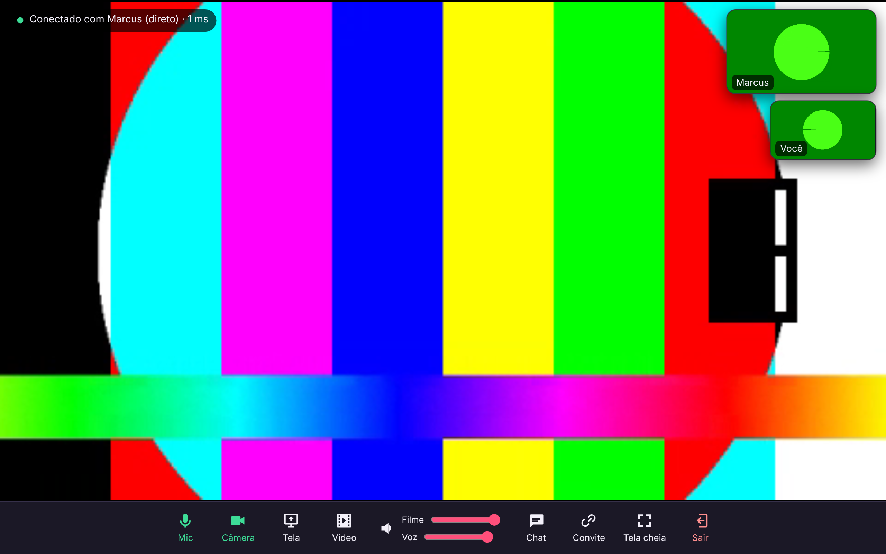

# 🍿 Cine a Dois

Para assistir filmes juntos à distância: **tela ou vídeo com áudio**, **voz**, **câmera** e **chat**, entrando por **link de convite com senha**.
Feito para substituir o Discord.



## Como funciona

```
Tablet A ──(WebRTC: vídeo/áudio direto, criptografado)──► Tablet B
    │                                                      │
    └──── wss://cine.seudominio ── servidor Node ──────────┘   (só apresenta os dois + chat)
                     coturn (TURN) ── ponte quando o 4G/roteador bloqueia ligação direta
```

- O filme **não passa pelo servidor** quando a ligação direta funciona. O status mostra *(direto)* ou *(via servidor)*.
- As salas ficam só na memória. Uma sala vazia some depois de 30 minutos, e nenhuma sala dura mais de 48 horas.
- Cabem 2 pessoas por sala. A senha é guardada como hash (scrypt), com limite de tentativas.

## Como usar

1. Abra o site, digite seu nome e, se quiser, uma senha. Toque em **Criar sala**.
2. Toque em **Convite** e mande o link pelo WhatsApp. A senha vai em uma mensagem separada.
3. Para transmitir:
   - **Vídeo**: escolha um arquivo de filme do aparelho (MP4/WebM). É o modo certo para **tablet Android**. Quem transmite controla o play, o pause e o avanço pelos controles do vídeo.
   - **Tela**: no **Chrome do computador**, compartilhe uma aba ou a tela e marque **“Compartilhar áudio”**. No Chrome do Android esse botão aparece apagado, porque o navegador ainda não permite compartilhar a tela.
4. Há volumes separados para **Filme** e **Voz**, além de **Tela cheia** (o tablet gira para a horizontal). Tocar no filme esconde a barra.

> ⚠️ Netflix, Prime, Disney+ e outros serviços com DRM aparecem **pretos** em qualquer captura (Discord inclusive). Use arquivos próprios ou sites sem DRM.
> 💡 Quem transmite um arquivo não deve deixar o vídeo no mudo, porque o áudio enviado sai do próprio player.

## Instalação na VPS (Hostinger, Ubuntu 22)

Pré-requisitos: Docker e Docker Compose, Nginx com Certbot e um subdomínio (ex.: `cine.campostecnologia.cloud`) apontando para o IP da VPS.

```bash
cd ~ && git clone <este-repo> && cd ecc-kit/watch-together
cp .env.example .env
nano .env        # DOMAIN, PUBLIC_IP (curl -4 ifconfig.me), TURN_SECRET (openssl rand -hex 32)
docker compose up -d --build
curl http://127.0.0.1:3100/health    # deve responder "ok"
```

**Firewall** (painel da Hostinger e `ufw`). Libere as portas do TURN:

```bash
ufw allow 3478/tcp && ufw allow 3478/udp && ufw allow 49160:49200/udp
```

**Nginx + HTTPS.** O HTTPS é obrigatório: sem ele o navegador não libera câmera nem microfone.

```bash
cp deploy/nginx-cine.conf /etc/nginx/sites-available/cine.conf   # ajuste o domínio
ln -s /etc/nginx/sites-available/cine.conf /etc/nginx/sites-enabled/
certbot --nginx -d cine.campostecnologia.cloud
nginx -t && systemctl reload nginx
```

Se o seu Nginx roda em container (`/root/stack`), ponha o serviço `app` na mesma rede Docker e use `proxy_pass http://cine-a-dois:3000`.

**Opcional:** preencha `ACCESS_CODE` no `.env` para exigir um código na hora de **criar** salas e impedir que estranhos usem seu servidor. Quem entra pelo convite não precisa do código.

Para atualizar: `git pull && docker compose up -d --build`.

## Desenvolvimento

```bash
npm install
npm start            # http://localhost:3000 (localhost conta como seguro para câmera)
npm test             # teste ponta a ponta com 2 navegadores (Playwright + ffmpeg)
```

| Arquivo | O quê |
|---|---|
| `server/index.js` | Servidor HTTP estático, sinalização WebSocket, salas, senha, credenciais TURN |
| `public/app.js` | WebRTC (perfect negotiation), tela/arquivo, câmera/mic, chat |
| `docker-compose.yml` | App + coturn |
| `deploy/nginx-cine.conf` | Proxy reverso com WebSocket |
